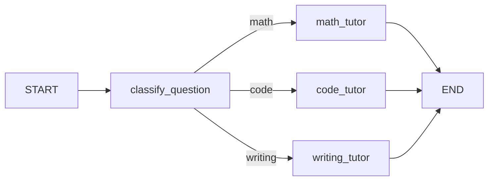
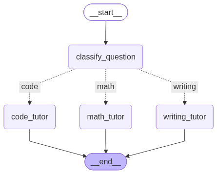

# 02. Routing

## Part 1 — Core Tutorial

Routing sends work down different paths depending on the input. One model call classifies the input into a small, fixed set of labels; plain code then sends it to the node that handles that label. Structured output makes the label reliable: no free-text parsing.



## When To Use

Use this pattern when different inputs need different handling (a different prompt, model, or flow) and you can list the destinations up front.

Examples:

- a student's question → the math, code, or writing tutor
- customer feedback → positive, negative, or neutral handling (`02b_routing_feedback.py`)
- a support ticket → billing or technical

If the categories would share nearly identical code, one parameterized prompt is simpler than a router.

## Part 2 — Code Example

File: `02_routing.py`



### How it works

**Classifier node** — the one model call. It returns a typed label and writes it to state:

```python
class TutorChoice(BaseModel):
    subject: Literal["math", "code", "writing"]

classifier = llm.with_structured_output(TutorChoice)

def classify_question(state: State) -> dict:
    choice = classifier.invoke([SystemMessage(...), HumanMessage(state["question"])])
    return {"subject": choice.subject}
```

**Router** — pure Python. It reads the label and returns it; the mapping turns labels into node names:

```python
def route_to_tutor(state: State) -> str:
    return state["subject"]

builder.add_conditional_edges("classify_question", route_to_tutor,
    {"math": "math_tutor", "code": "code_tutor", "writing": "writing_tutor"})
```

**Tutor nodes** — same shape, each with its own system prompt (`TUTOR_STYLE`), built by a small `make_tutor(subject)` factory.

### State

| Field | Set by | Used by |
|---|---|---|
| `question` | caller | classifier + tutors |
| `subject` | `classify_question` | `route_to_tutor` |
| `answer` | the chosen tutor | caller |

### Key idea

The model call lives in a **node**, where its output is captured in state; the branching lives in a **router** that only reads state. Because `subject` is a `Literal`, it is always exactly `"math"`, `"code"`, or `"writing"`, so the router never guesses.

## Exercises

**Exercise 1 — Add a fourth route.** Add `"science"` to `TutorChoice`, a `TUTOR_STYLE` entry, and the mapping. Test with "Why is the sky blue?".

**Exercise 2 — A cheaper router.** Use a smaller, faster model for `classify_question` only, and keep the stronger one for the tutors. Does the routing change on the three sample questions?
