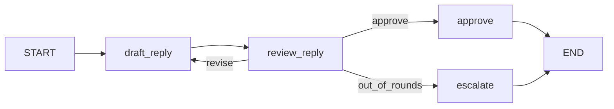

# 05. Evaluator-Optimizer

## Part 1 — The pattern

An evaluator-optimizer workflow is a loop between two roles: a **writer** that produces a draft and a **reviewer** that judges it. If the draft passes, the loop ends. If not, the reviewer's critique travels back to the writer in state, and the writer revises.

It's the only workflow pattern with a cycle, and it's how a lot of human work runs: a support agent writes, a team lead reviews, the agent fixes what was flagged.

```text
complaint → draft_reply → review_reply ──approve──→ done
                 ▲              │
                 └── revise ────┘   (critique + previous draft in state)
```

Three design choices separate a loop that improves from one that merely retries:

1. **The verdict is structured.** The reviewer returns a typed object, so the router branches on `"approve"` / `"revise"` instead of parsing prose.
2. **The writer revises, it doesn't restart.** On a retry the prompt carries the previous draft *and* the critique. A writer that sees only the critique writes a new reply with new problems.
3. **The reviewer is code plus a model.** Anything code can check exactly (length, required fields, a regex, a test suite) runs first, for free. The model gets only the questions that need judgment.

## When to use it

Use it when:

- one pass is often not good enough, and
- "good enough" can be written down: a policy, a rubric, a checklist, tests, and
- the writer can act on a critique.

Examples: support replies that must follow a policy, marketing copy that must meet a brief, a summary that must keep every number, code that must pass its tests.

Skip it when there's no real check (the loop has nothing to steer by) or when the first draft is usually fine (one review pass, no loop, is enough).

## Part 2 — Support-reply reviewer

File: `05_evaluator_optimizer.py`

A customer was charged twice and wants their money back today. The writer drafts a reply without seeing the policy. The reviewer owns the policy:

1. Name the customer's specific problem.
2. Apologize once, without blaming the customer.
3. Give one concrete next step and when it will happen.
4. Never promise a refund, credit, or compensation: only billing can.
5. Stay under 120 words.

### State

| Field | Written by | Read by |
|---|---|---|
| `complaint` | caller | writer, reviewer |
| `draft` | `draft_reply` | `review_reply`, and the writer on a retry |
| `verdict` | `review_reply` | router |
| `critique` | `review_reply` | `draft_reply` |
| `rounds` | `review_reply` | printing (and the cap in Part 3) |

### The reviewer's verdict

```python
class Review(BaseModel):
    verdict: Literal["approve", "revise"]
    critique: str   # instructions for the writer; empty when approved
```

`review_reply` checks the word count in code first. Only a draft that fits is sent to the model with the policy.

### Graph


A typical run: round 1 fails the word count (code), round 2 promises a refund (model), round 3 is approved.

## Part 3 — Bound the loop

File: `05_evaluator_optimizer_max_iterations.py`

The base graph exits only on approval. If the reviewer never approves, or the router misreads the verdict, the loop runs until LangGraph's recursion limit. In `langgraph==1.2.6` that default is **10,007 steps**: thousands of paid calls. Never rely on it for a loop that calls a model; set `config={"recursion_limit": ...}` and, better, design your own exit.

The bounded version adds:

- `rounds` in state, incremented in `review_reply` (it counts reviews, where the draft is judged);
- a third router exit, `"out_of_rounds"`, after `MAX_ROUNDS = 3`;
- an `escalate` node: a draft that never passed review goes to a person with the open critique, instead of to the customer.



The script runs the complaint twice: with the normal 120-word policy (usually approved in 1–3 rounds) and with a 40-word policy, which usually ends in `escalated`. Watch how fixing one rule often breaks another; that trading is why the cap exists.

## Part 4 — Exercises

Solutions are in `Exercise-Solutions/5-workflows/`.

1. **Add a round cap** to `05_evaluator_optimizer.py` (`ex4_evaluator_loop_guard.py`).
2. **Swap the domain**: the same loop for news headlines, graded `"clear"` / `"unclear"`, with code checks for length and clickbait phrases in front of the judge (`ex5_evaluator_headline_writer.py`).
3. **A numeric bar**: have the reviewer return a `score` from 1 to 10 and approve only at 8 or above, with the threshold in code (`ex6_evaluator_strict_score.py`).
