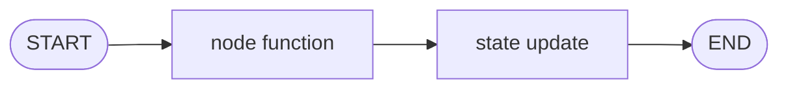
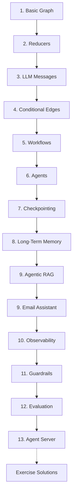

# LangGraph Tutorials

A beginner-friendly tutorial repo for learning LangGraph one concept at a time. It is the companion code for the book *Building AI Agents with LangGraph*.

This repo is meant to feel like a guided path, not a code dump. Each folder introduces one idea, explains why it matters, then uses a small Python file to make the idea concrete.

You need basic Python (functions, dictionaries, classes). An OpenAI API key is needed from tutorial 3 onward; tutorials 1, 2 and 4 run without one.

## Quick Start

Python 3.10 or newer is required. From the repo root:

```bash
python3 -m venv .venv
source .venv/bin/activate
pip install -r requirements.txt
```

Most tutorials call an LLM. Create a `.env` file in the repo root:

```bash
OPENAI_API_KEY=your_api_key_here
```

For the tool-calling agent in tutorial 6, optionally add keys for live weather and web search:

```bash
OPENWEATHER_API_KEY=your_openweather_key_here
TAVILY_API_KEY=your_tavily_key_here
```

Tutorial 10 reads its LangSmith keys from `10-observability/.env` (see its README). Tutorials 7 and 8 have optional PostgreSQL examples; set up the database once with [`13-Postgres-Setup/`](13-Postgres-Setup/README.md) and add its `DB_URI` to the root `.env`.

Then run the first example, always from the repo root:

```bash
python "1-Langgraph basics/00_simple_graph.py"
```

## Reading Along With the Book

The folder numbers follow the order the tutorials were written, not the book's chapter numbers. Use this table to find the code for the chapter you are reading. Every listing caption in the book also names its file.

| Book chapter | Repo folder | Exercise solutions |
|---|---|---|
| 1. Why LangGraph? | none (concepts only) | pencil and paper, Appendix B |
| 2. Your First Graph | [`1-Langgraph basics/`](1-Langgraph%20basics/) | [`Exercise-Solutions/1-basics/`](Exercise-Solutions/1-basics/) |
| 3. Reducers and Chat History | [`2-Reducer/`](2-Reducer/) and [`3_LLM_Messages/`](3_LLM_Messages/) | [`2-reducers/`](Exercise-Solutions/2-reducers/), [`3-llm-messages/`](Exercise-Solutions/3-llm-messages/) |
| 4. Conditional Edges | [`4-Conditional Edges/`](4-Conditional%20Edges/) | [`4-conditional-edges/`](Exercise-Solutions/4-conditional-edges/) |
| 5. Workflow Patterns | [`5-Workflows/`](5-Workflows/) | [`5-workflows/`](Exercise-Solutions/5-workflows/) |
| 6. Tools | [`6-Agents/`](6-Agents/) (`00a`, `00b`, `05`, `05a`, `doc_tools.py`) | [`6-agents/`](Exercise-Solutions/6-agents/) |
| 7. Agents and the ReAct Loop | [`6-Agents/`](6-Agents/) (`00`–`04`, `06`, `07`) | [`6-agents/`](Exercise-Solutions/6-agents/) |
| 8. Acting Agents and Multi-Agent Handoffs | [`6-Agents/`](6-Agents/) (`08-notify-agent/`, `09`–`13`) | Appendix B only |
| 9. Checkpointing | [`7-Checkpointing/`](7-Checkpointing/) | Appendix B only |
| 10. Long-Term Memory | [`8-Long-Term-Memory/`](8-Long-Term-Memory/) (`00`–`03`) | Appendix B only |
| 11. Memory Types | [`8-Long-Term-Memory/`](8-Long-Term-Memory/) (`04`–`06`, `07-skills/`) | Appendix B only |
| 12. Capstone I: Two Complete Agents | [`9-Agentic-RAG/`](9-Agentic-RAG/README.md) (§12.1) and [`9-Email-Assistant/`](9-Email-Assistant/) (§12.2) | — |
| 13. Observability | [`10-observability/`](10-observability/) | Appendix B only |
| 14. Evaluation | [`12-Evaluation/`](12-Evaluation/README.md) | [`12-evaluation-agentic-rag/`](Exercise-Solutions/12-evaluation-agentic-rag/) |
| 15. Guardrails | [`11-Guardrials/`](11-Guardrials/README.md) | — |
| 16. Deployment | [`13-Agent-Server/`](13-Agent-Server/) | [`13-agent-server/`](Exercise-Solutions/13-agent-server/) |
| Appendix F. PostgreSQL | [`13-Postgres-Setup/`](13-Postgres-Setup/README.md) | — |

## Flashcards

Every chapter with code has a deck of print-ready code cards in its folder: one A4 page per concept, with a takeaway, two bullets and a commented snippet from the chapter's code.

| Chapter | Deck |
|---|---|
| 1. Why LangGraph? | [PDF](1-Langgraph%20basics/ch01_why_langgraph_flashcards.pdf) · [PPTX](1-Langgraph%20basics/ch01_why_langgraph_flashcards.pptx) (7 cards) |
| 2. Your First Graph | [PDF](1-Langgraph%20basics/ch02_first_graph_flashcards.pdf) · [PPTX](1-Langgraph%20basics/ch02_first_graph_flashcards.pptx) (7 cards) |
| 3. Reducers and Chat History | [PDF](2-Reducer/ch03_reducers_flashcards.pdf) · [PPTX](2-Reducer/ch03_reducers_flashcards.pptx) (11 cards) |
| 4. Conditional Edges | [PDF](4-Conditional%20Edges/ch04_conditional_edges_flashcards.pdf) · [PPTX](4-Conditional%20Edges/ch04_conditional_edges_flashcards.pptx) (10 cards) |
| 5. Workflow Patterns | [PDF](5-Workflows/ch05_workflows_flashcards.pdf) · [PPTX](5-Workflows/ch05_workflows_flashcards.pptx) (12 cards) |
| 6. Tools and Tool Calling | [PDF](6-Agents/ch06_tools_flashcards.pdf) · [PPTX](6-Agents/ch06_tools_flashcards.pptx) (10 cards) |
| 7. Agents and the ReAct Loop | [PDF](6-Agents/ch07_agents_flashcards.pdf) · [PPTX](6-Agents/ch07_agents_flashcards.pptx) (12 cards) |
| 8. Acting Agents and Multi-Agent Handoffs | [PDF](6-Agents/ch08_acting_agents_flashcards.pdf) · [PPTX](6-Agents/ch08_acting_agents_flashcards.pptx) (12 cards) |
| 9. Checkpointing | [PDF](7-Checkpointing/ch09_checkpointing_flashcards.pdf) · [PPTX](7-Checkpointing/ch09_checkpointing_flashcards.pptx) (12 cards) |
| 10. Long-Term Memory | [PDF](8-Long-Term-Memory/ch10_long_term_memory_flashcards.pdf) · [PPTX](8-Long-Term-Memory/ch10_long_term_memory_flashcards.pptx) (9 cards) |
| 11. Semantic, Episodic & Procedural Memory | [PDF](8-Long-Term-Memory/ch11_memory_types_flashcards.pdf) · [PPTX](8-Long-Term-Memory/ch11_memory_types_flashcards.pptx) (11 cards) |
| 12. Two Complete Agents | [PDF](9-Agentic-RAG/ch12_capstone_flashcards.pdf) · [PPTX](9-Agentic-RAG/ch12_capstone_flashcards.pptx) (12 cards) |
| 13. Observability | [PDF](10-observability/ch13_observability_flashcards.pdf) · [PPTX](10-observability/ch13_observability_flashcards.pptx) (11 cards) |
| 14. Evaluation | [PDF](12-Evaluation/ch14_evaluation_flashcards.pdf) · [PPTX](12-Evaluation/ch14_evaluation_flashcards.pptx) (13 cards) |
| 15. Guardrails | [PDF](11-Guardrials/guardrails_flashcards.pdf) · [PPTX](11-Guardrials/guardrails_flashcards.pptx) (18 slides) |
| 16. Deployment | [PDF](13-Agent-Server/ch16_deployment_flashcards.pdf) · [PPTX](13-Agent-Server/ch16_deployment_flashcards.pptx) (12 cards) |

## The Core Idea

LangGraph lets you build workflows as graphs. A graph is made of three main pieces:

| Piece | Meaning | Simple Way To Think About It |
|---|---|---|
| State | Data moving through the graph | The backpack your workflow carries |
| Node | A function that does work | A step in the workflow |
| Edge | A connection between nodes | The road to the next step |



This repo follows the official LangGraph mental model: define **state**, run **nodes**, connect them with **edges**, then compile the graph into something you can invoke. The examples are small so the idea is visible before the code becomes realistic.

## Learning Path

The tutorials build on each other, so work through them in order:



| # | Folder | What you learn | Needs |
|---|---|---|---|
| 1 | [`1-Langgraph basics/`](1-Langgraph%20basics/) | The smallest graph: state, node, edge, compile, invoke | — |
| 2 | [`2-Reducer/`](2-Reducer/) | How reducers preserve or combine state updates | — |
| 3 | [`3_LLM_Messages/`](3_LLM_Messages/) | Chat history in graph state | OpenAI |
| 4 | [`4-Conditional Edges/`](4-Conditional%20Edges/) | Routing to different nodes | — |
| 5 | [`5-Workflows/`](5-Workflows/) | Prompt chaining, routing, parallelization, orchestrator-workers, evaluator-optimizer, local RAG | OpenAI |
| 6 | [`6-Agents/`](6-Agents/) | Manual routers, `Command`, `ToolNode`, `create_agent`, two-agent handoff | OpenAI (optional: weather, Tavily) |
| 7 | [`7-Checkpointing/`](7-Checkpointing/) | Short-term memory per `thread_id`: `MemorySaver`, history, resume, human-in-the-loop, `PostgresSaver` | OpenAI; PostgreSQL for the last step |
| 8 | [`8-Long-Term-Memory/`](8-Long-Term-Memory/) | Cross-conversation memory with a Store: namespaces, `PostgresStore`, semantic/episodic/procedural memory | OpenAI; PostgreSQL for `03-postgres-store/` |
| 9 | [`9-Email-Assistant/`](9-Email-Assistant/) | A complete assistant built gradually: routing, tools, and every memory type | OpenAI |
| 9 | [`9-Agentic-RAG/`](9-Agentic-RAG/README.md) | An agentic RAG chatbot over company files: Chroma, `create_agent`, a search tool it chooses to call, live weather (book Chapter 12) | OpenAI; LangSmith optional |
| 10 | [`10-observability/`](10-observability/) | LangSmith tracing of graphs, LLM calls and nodes | OpenAI, LangSmith |
| 11 | [`11-Guardrials/`](11-Guardrials/README.md) | Guardrails with LangChain middleware: PII detection, human-in-the-loop, input/output checks (notebook, book Chapter 15) | OpenAI; Jupyter |
| 12 | [`12-Evaluation/`](12-Evaluation/README.md) | Evaluating the Chapter 12 chatbot: golden set, code and LLM-judge metrics, a CI gate with a regression check, online scores and human review (book Chapter 14) | No keys for the minimal example; OpenAI and LangSmith for the rest |
| 13 | [`13-Agent-Server/`](13-Agent-Server/) | A command mailbox on LangGraph Server: one node, `PING` and `GET_STATUS`, thread reuse (book Chapter 16) | No API key. Its own `.venv` inside `pending-command-demo/` |
| — | [`13-Postgres-Setup/`](13-Postgres-Setup/README.md) | One-time PostgreSQL setup for the Postgres examples in tutorials 7 and 8: role, database, `DB_URI`, `.setup()`, a pool (book Appendix F) | A local PostgreSQL server |
| — | [`Exercise-Solutions/`](Exercise-Solutions/) | Runnable answers to the exercises of book Chapters 2–7, 14 and 16. Try the exercises first | OpenAI for some |

Each folder has its own README that works like a mini lesson. Each one follows the same rhythm:

1. the concept and the problem it solves, in plain language with an intuition-building analogy
2. the architecture of the example — a diagram and a table of what each stage reads and writes
3. code highlights explaining *why* the important lines are designed the way they are
4. a step-by-step execution walkthrough showing how state evolves
5. exercises (with solutions in `Exercise-Solutions/`) and key takeaways

## Memory in This Repo

LangGraph uses the word "memory" for two different scopes, and this repo
teaches them in two separate tutorials:

| Scope | Remembers | Identified by | Temporary / durable | Tutorial |
|---|---|---|---|---|
| Short-term | one conversation's messages and graph state | `thread_id` | `MemorySaver` / `PostgresSaver` | [`7-Checkpointing/`](7-Checkpointing/) |
| Long-term | selected user or app facts shared across conversations | namespace containing `user_id` | `InMemoryStore` / `PostgresStore` | [`8-Long-Term-Memory/`](8-Long-Term-Memory/) |

[`9-Email-Assistant/`](9-Email-Assistant/) then combines both in one
application. The details (savers, Stores, and semantic, episodic and
procedural memory) live in those tutorials' READMEs.

## Troubleshooting

| Problem | Fix |
|---|---|
| `ModuleNotFoundError: No module named 'langgraph'` | Activate the virtual environment and run `pip install -r requirements.txt` |
| `OpenAI` authentication error in tutorials 3 and 5–11 | Check that `.env` exists in the repo root and contains a valid `OPENAI_API_KEY` |
| Tutorial 10 cannot find `.env` or LangSmith keys | Copy `10-observability/.env.example` to `10-observability/.env`. Those scripts load env from **that** folder, not the repo root. Run 01–02 as `python 01_….py` and file 03 as `python 03_multi_tool_agent/main.py` from `10-observability/` |
| `jupyter: command not found` (tutorials 10 and 11) | The notebooks need Jupyter, which is not in `requirements.txt`: `pip install notebook` |
| `KeyError: 'DB_URI'` or a PostgreSQL connection error | Follow [`13-Postgres-Setup/`](13-Postgres-Setup/README.md), then run `python 13-Postgres-Setup/03-verify_connection.py` |
| Run commands fail with "file not found" | Run commands from the repo root, not from inside a tutorial folder (tutorial 10 runs from `10-observability/`; tutorial 12 documents the working folder for each example in its README) |

## Official References Used

These tutorials are enriched from the official LangChain and LangGraph docs, then simplified into beginner examples:

- [LangGraph overview](https://docs.langchain.com/oss/python/langgraph/overview)
- [LangGraph Graph API](https://docs.langchain.com/oss/python/langgraph/graph-api)
- [LangGraph workflows and agents](https://docs.langchain.com/oss/python/langgraph/workflows-agents)
- [LangGraph memory](https://docs.langchain.com/oss/python/langgraph/add-memory)
- [LangChain tools](https://docs.langchain.com/oss/python/langchain/tools)
- [LangChain structured output](https://docs.langchain.com/oss/python/langchain/structured-output)

## Tested Versions and Updates

The book *Building AI Agents with LangGraph* was written against the versions pinned in [`requirements.txt`](requirements.txt) (current as of September 2026), including `langgraph==1.2.6`, `langchain==1.3.11`, `langchain-openai==1.3.3` and `langmem==0.0.30`. Install that file and every example runs as printed in the book.

LangGraph moves quickly. When an upgrade changes an import or a default, the examples here are updated and the change is logged below, so readers of the printed book can see what moved.

| Date | Library change | What changed in this repo |
|---|---|---|
| 2026-09 | — | Baseline for the first edition. |
